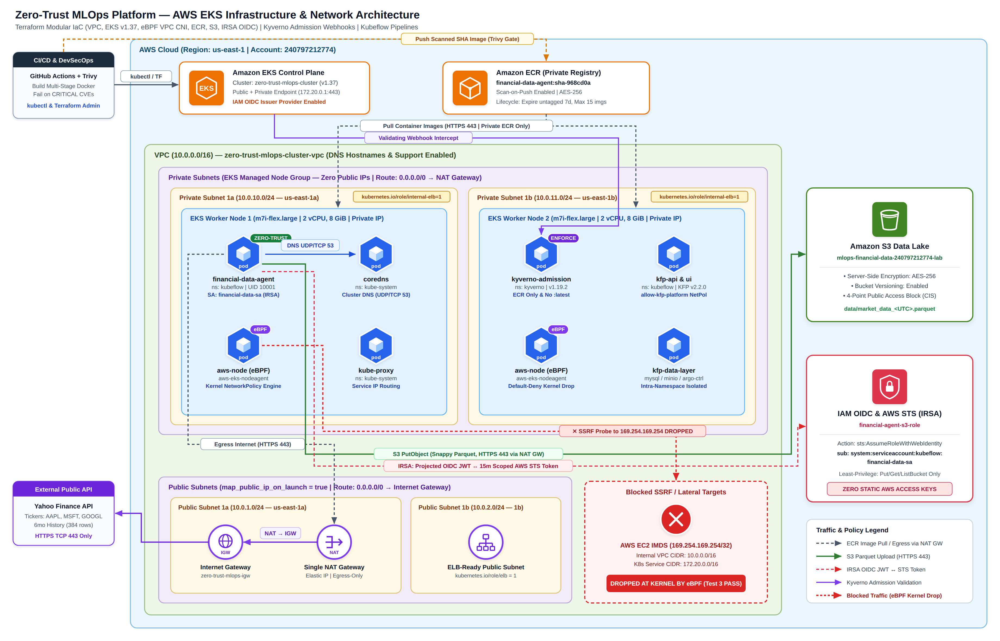
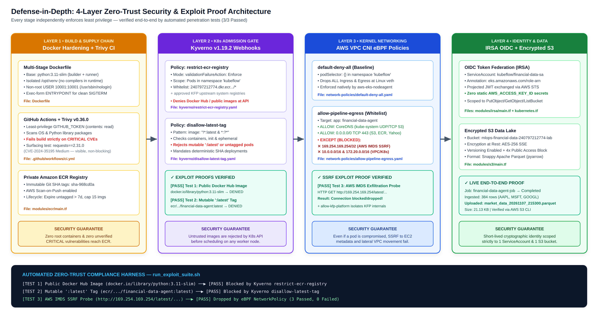
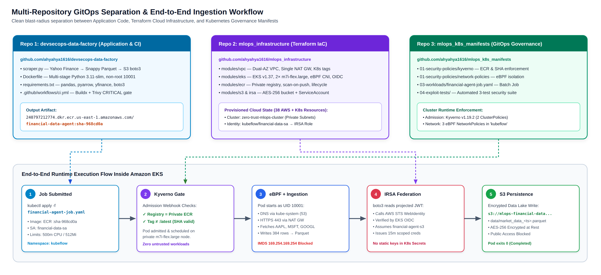

# Zero-Trust DevSecOps & MLOps Platform on Amazon EKS

[](https://aws.amazon.com/eks/)
[](https://www.terraform.io/)
[](https://kyverno.io/)
[](https://docs.aws.amazon.com/eks/latest/userguide/cni-network-policy.html)
[](https://trivy.dev/)
[-3776AB?style=for-the-badge&logo=python&logoColor=white)](https://www.python.org/)
[](#empirical-security-verification--exploit-proof-suite)

> **Enterprise-hardened, Zero-Trust MLOps Data Factory** built across three decoupled GitOps repositories. Provisions an isolated Amazon EKS cluster with modular Terraform, enforces container supply-chain governance via **Kyverno** admission webhooks, isolates pod networking at the Linux kernel level via **AWS VPC CNI native eBPF**, eliminates static credentials with **IAM Roles for Service Accounts (IRSA)**, and validates every security control empirically with an automated penetration test suite.

---

## Table of Contents

1. [Infrastructure & Network Architecture](#1-infrastructure--network-architecture)
2. [Defense-in-Depth: 4-Layer Zero-Trust Security](#2-defense-in-depth-4-layer-zero-trust-security)
3. [Multi-Repository GitOps Structure & Runtime Flow](#3-multi-repository-gitops-structure--runtime-flow)
4. [Complete File-by-File Reference](#4-complete-file-by-file-reference)
5. [Empirical Security Verification & Exploit Proof Suite](#5-empirical-security-verification--exploit-proof-suite)
6. [End-to-End Deployment & Operations Runbook](#6-end-to-end-deployment--operations-runbook)
7. [Key Engineering Decisions & Cost Guardrails](#7-key-engineering-decisions--cost-guardrails)

---

## 1. Infrastructure & Network Architecture

The cloud infrastructure is provisioned entirely via modular **Terraform** (`us-east-1`, Account `240797212774`). Every compute workload runs strictly inside **private subnets** with zero public IP exposure, routing outbound HTTPS traffic through a cost-optimized single NAT Gateway while authenticating passwordlessly to AWS via OIDC federation.



### Network & CIDR Design (`modules/vpc`)

| Network Tier | CIDR Block | Availability Zone | Public IP Assignment | Default Route (`0.0.0.0/0`) | Kubernetes Auto-Discovery Tag |
| :--- | :--- | :--- | :--- | :--- | :--- |
| **VPC** | `10.0.0.0/16` | Multi-AZ (`us-east-1a`, `1b`) | — | Local VPC DNS (`enable_dns_hostnames`) | `kubernetes.io/cluster/zero-trust-mlops-cluster = shared` |
| **Public Subnet 1a** | `10.0.1.0/24` | `us-east-1a` | Enabled (`true`) | Internet Gateway (`zero-trust-mlops-igw`) | `kubernetes.io/role/elb = 1` (Hosts Single NAT GW + EIP) |
| **Public Subnet 1b** | `10.0.2.0/24` | `us-east-1b` | Enabled (`true`) | Internet Gateway (`zero-trust-mlops-igw`) | `kubernetes.io/role/elb = 1` (ELB-Ready Edge) |
| **Private Subnet 1a** | `10.0.10.0/24` | `us-east-1a` | **Disabled (`false`)** | Single NAT Gateway (`nat-gw`) | `kubernetes.io/role/internal-elb = 1` (Hosts EKS Worker Node 1) |
| **Private Subnet 1b** | `10.0.11.0/24` | `us-east-1b` | **Disabled (`false`)** | Single NAT Gateway (`nat-gw`) | `kubernetes.io/role/internal-elb = 1` (Hosts EKS Worker Node 2) |

### Compute, Control Plane & Storage Specifications

* **Amazon EKS Control Plane (`modules/eks`)**: Kubernetes `v1.37` (`zero-trust-mlops-cluster`) with both `endpoint_public_access = true` (admin `kubectl`) and `endpoint_private_access = true` (private node-to-API communication over VPC backbone at `172.20.0.1:443`).
* **Managed Worker Node Group**: `2× m7i-flex.large` On-Demand nodes (`2 vCPU, 8 GiB RAM`, x86_64, scaling `min=1 / desired=2 / max=3`, `max_unavailable = 1`) locked inside `private_subnet_ids`.
* **Managed EKS Add-ons (`modules/eks/addons.tf`)**:
  * `vpc-cni` configured with `enableNetworkPolicy = "true"` to run the native **`aws-eks-nodeagent` eBPF engine** without third-party CNI overhead.
  * `coredns` (cluster DNS on `UDP/TCP 53`) and `kube-proxy` (ClusterIP service routing).
* **Private Amazon ECR (`modules/ecr`)**: `240797212774.dkr.ecr.us-east-1.amazonaws.com/financial-data-agent` with `scan_on_push = true`, AES-256 encryption, `force_delete = true`, and a 2-rule lifecycle policy (expire untagged images after 7 days; retain at most 15 tagged images prefixed with `v`, `sha-`, `main-`).
* **Encrypted Amazon S3 Data Lake (`modules/s3`)**: `s3://mlops-financial-data-240797212774-lab` hardened with **AES-256 Server-Side Encryption**, **Versioning Enabled**, `force_destroy = true`, and the full **4-point CIS Public Access Block**.

---

## 2. Defense-in-Depth: 4-Layer Zero-Trust Security

No single control is trusted in isolation. Every container must pass four independent cryptographic and kernel-level security boundaries before writing a single byte to Amazon S3:



### Layer 1: Hardened Container & CI/CD Supply Chain (`Dockerfile`, `.github/workflows/ci.yml`)
* **Multi-Stage Isolation**: Stage 1 (`python:3.11-slim AS builder`) installs Python wheels into `/opt/venv`. Stage 2 (`python:3.11-slim AS runner`) copies only `/opt/venv` and `scraper.py`, keeping build tools and pip caches out of runtime.
* **CIS Non-Root Execution**: Drops root privileges via a dedicated system user `appuser` (`USER 10001:10001`) with `/usr/sbin/nologin` shell and exec-form `ENTRYPOINT ["python", "scraper.py"]` for clean `SIGTERM` handling.
* **Shift-Left Trivy Vulnerability Gate**: GitHub Actions runs with least-privilege `permissions: contents: read` and scans every build with **Aqua Security Trivy `v0.36.0`** (`vuln-type: os,library`). Builds fail strictly on `CRITICAL` CVEs (`exit-code: 1`), while intentionally pinned `requests==2.31.0` (`CVE-2024-35195`, Medium severity) proves scanner visibility without falsely halting deployments.

### Layer 2: Kubernetes Admission Control (`kyverno/`)
* **Kyverno `v1.19.2`** intercepts every `Pod` admission request targeting the `kubeflow` namespace in `Enforce` mode:
  * `restrict-ecr-registry`: Restricts `containers`, `initContainers`, and `ephemeralContainers` strictly to `240797212774.dkr.ecr.us-east-1.amazonaws.com/*` plus explicitly allow-listed upstream Kubeflow Pipelines system registries (`gcr.io/ml-pipeline/*`, `gcr.io/tfx-oss-public/*`, `docker.io/library/mysql:*`, `docker.io/minio/minio:*`, `quay.io/argoproj/*`). Public Docker Hub workload images are rejected at the API boundary.
  * `disallow-latest-tag`: Enforces pattern `"!*:latest & *:?*"` across all container types, eliminating mutable `:latest` or untagged rollouts in favor of immutable Git SHA tags (`sha-968cd0a`).

### Layer 3: Kernel-Level Micro-Segmentation via eBPF (`network-policies/`)
* **`default-deny-all`**: Selects all pods (`podSelector: {}`) in `kubeflow` and drops all unsolicited ingress and egress packets directly at the Linux kernel `veth` interface.
* **`allow-pipeline-egress`**: Scoped strictly to `app: financial-data-agent`, allowing ONLY:
  1. DNS resolution (`UDP/TCP 53`) to `kube-dns` in `kube-system`.
  2. External HTTPS egress (`TCP 443`) to `0.0.0.0/0` **with explicit `except` CIDR drops**:
     * `169.254.169.254/32` — **Blocks AWS EC2 Instance Metadata Service (IMDS) SSRF attacks**.
     * `10.0.0.0/16` — Blocks lateral movement to internal VPC nodes and databases.
     * `172.20.0.0/16` — Blocks unauthorized access to internal Kubernetes ClusterIP services.
* **`allow-kfp-platform`**: Scoped strictly to `application-crd-id: kubeflow-pipelines`, permitting intra-namespace microservice communication (`ml-pipeline`, `mysql`, `minio`, `workflow-controller`), CoreDNS, and Kubernetes API server calls while still blocking `169.254.169.254/32`.

### Layer 4: Passwordless Cloud Identity via IRSA (`modules/irsa`, `modules/eks/oidc.tf`)
* Zero static `AWS_ACCESS_KEY_ID` or `AWS_SECRET_ACCESS_KEY` secrets exist anywhere in the cluster or repositories.
* Terraform registers the EKS OIDC issuer (`aws_iam_openid_connect_provider`) using its TLS SHA-1 thumbprint and creates IAM role `zero-trust-mlops-cluster-financial-agent-s3-role` with a strict OIDC trust condition:
  * `sub == "system:serviceaccount:kubeflow:financial-data-sa"`
  * `aud == "sts.amazonaws.com"`
* The attached IAM policy grants least-privilege `s3:PutObject`, `s3:GetObject`, and `s3:ListBucket` exclusively to `arn:aws:s3:::mlops-financial-data-240797212774-lab` and its objects.
* At runtime, `boto3` transparently exchanges the projected JWT token (`/var/run/secrets/eks.amazonaws.com/serviceaccount/token`) via `sts:AssumeRoleWithWebIdentity` for short-lived temporary credentials.

---

## 3. Multi-Repository GitOps Structure & Runtime Flow

To enforce clean separation of concerns, independent CI/CD lifecycles, and minimal blast radius, the platform is split across three dedicated Git repositories:



| Repository | Remote URL | Ownership & Responsibility |
| :--- | :--- | :--- |
| **1. Application & CI** | [`github.com/ahyahya1616/devsecops-data-factory`](https://github.com/ahyahya1616/devsecops-data-factory) | Python financial ingestion agent (`scraper.py`), hardened multi-stage `Dockerfile`, pinned `requirements.txt`, GitHub Actions + Trivy CI workflow. |
| **2. Cloud Infrastructure (IaC)** | [`github.com/ahyahya1616/mlops_infrastructure`](https://github.com/ahyahya1616/mlops_infrastructure) | Modular Terraform provisioning VPC, EKS `v1.37`, eBPF VPC CNI, OIDC Provider, Amazon ECR, Encrypted S3, IAM IRSA Role, and Kubernetes `financial-data-sa`. |
| **3. Kubernetes Manifests (GitOps)** | [`github.com/ahyahya1616/mlops_k8s_manifests`](https://github.com/ahyahya1616/mlops_k8s_manifests) | Kyverno Helm installer & `ClusterPolicy` manifests, eBPF `NetworkPolicy` isolation rules, Batch Job workload, Kubeflow Pipelines, and automated exploit test suite. |

---

## 4. Complete File-by-File Reference

### Repo 1: Application & CI (`devsecops-data-factory`)

```text
mlops_project/
├── scraper.py                                # Fetches AAPL/MSFT/GOOGL (6mo), writes Snappy Parquet, uploads to S3 via IRSA
├── Dockerfile                                # Multi-stage python:3.11-slim build, isolated /opt/venv, non-root UID 10001:10001
├── .dockerignore                             # Excludes .git, caches, local .parquet/.env/venv from Docker build context
├── requirements.txt                          # pandas, pyarrow, yfinance, boto3 + intentional requests==2.31.0 for Trivy verification
├── .github/workflows/ci.yml                  # GitHub Actions: Buildx + Aqua Trivy v0.36.0 CRITICAL gate + OIDC ECR publish template
├── docs/architecture/                        # High-resolution AWS & Zero-Trust architecture diagrams embedded in this README
└── PROJECT_HANDOVER_AND_ARCHITECTURE.md      # Operational handover and rapid-resume runbook
```

### Repo 2: Modular Terraform Infrastructure (`mlops_infrastructure`)

```text
mlops_infrastructure/
├── versions.tf                               # Terraform >=1.6, AWS ~>5.0, TLS ~>4.0, dynamic EKS-exec Kubernetes ~>2.30 provider
├── main.tf                                   # Root orchestrator wiring vpc → eks → ecr / s3 → irsa modules
├── variables.tf / terraform.tfvars           # Region (us-east-1), CIDRs, EKS 1.37, m7i-flex.large, bucket & SA names
├── outputs.tf                                # Cluster endpoint, NAT EIP, OIDC ARN, ECR URI, S3 ARN, IRSA ARN, kubectl helper
└── modules/
    ├── vpc/main.tf                           # VPC 10.0.0.0/16, 2 public + 2 private subnets, IGW, 1 NAT GW + EIP, route tables, K8s tags
    ├── eks/main.tf                           # EKS cluster, Cluster/Node IAM roles, private Managed Node Group (2x m7i-flex.large)
    ├── eks/addons.tf                         # Managed addons: vpc-cni (enableNetworkPolicy=true), coredns, kube-proxy
    ├── eks/oidc.tf                           # TLS thumbprint extraction & aws_iam_openid_connect_provider for IRSA
    ├── ecr/main.tf                           # Private ECR repo, scan_on_push, force_delete, 7d untagged / max 15 tagged lifecycle
    ├── s3/main.tf                            # Encrypted S3 bucket (AES-256), versioning, 4-point Public Access Block, force_destroy
    └── irsa/
        ├── main.tf                           # OIDC Trust Policy (sts:AssumeRoleWithWebIdentity) + least-privilege S3 IAM policy
        └── kubernetes.tf                     # Creates 'kubeflow' namespace and 'financial-data-sa' annotated with IAM Role ARN
```

### Repo 3: Kubernetes Security & Workload Manifests (`mlops_k8s_manifests`)

```text
mlops_k8s_manifests/
├── 01-security-policies/
│   ├── kyverno/
│   │   ├── install.sh                        # Installs Kyverno via Helm into 'kyverno' namespace
│   │   ├── restrict-ecr-registry.yaml        # ClusterPolicy (Enforce): Blocks public registries in 'kubeflow'
│   │   └── disallow-latest-tag.yaml          # ClusterPolicy (Enforce): Blocks ':latest' and untagged images
│   └── network-policies/
│       ├── default-deny-all.yaml             # Kernel-level default-deny Ingress + Egress for all pods in 'kubeflow'
│       ├── allow-pipeline-egress.yaml        # Allows DNS 53 + HTTPS 443 for financial-data-agent; blocks IMDS/VPC/Service CIDRs
│       └── allow-kfp-platform.yaml           # Intra-namespace + DNS + API server egress for Kubeflow Pipelines components
├── 03-workloads/
│   └── financial-agent-job.yaml              # Kubernetes Batch Job running ECR SHA image with financial-data-sa (250m/256Mi–500m/512Mi)
└── 04-exploit-tests/
    ├── test1-blocked-public-image.yaml       # Exploit 1: Attempts docker.io/library/python:3.11-slim (Expected: Kyverno DENY)
    ├── test2-blocked-latest-tag.yaml         # Exploit 2: Attempts private ECR with ':latest' tag (Expected: Kyverno DENY)
    ├── test3-metadata-ssrf-probe.yaml        # Exploit 3: Probes http://169.254.169.254/latest/meta-data/ (Expected: eBPF DROP)
    └── run_exploit_suite.sh                  # Automated penetration-testing harness validating all 3 security controls
```

---

## 5. Empirical Security Verification & Exploit Proof Suite

Every Zero-Trust claim was verified live against the running Amazon EKS cluster.

### Automated Exploit Suite Results (`./04-exploit-tests/run_exploit_suite.sh`)

| Test Case | Simulated Attack Vector | Enforcement Mechanism | Observed Outcome | Status |
| :--- | :--- | :--- | :--- | :---: |
| **Test 1** | Supply-chain poisoning using `docker.io/library/python:3.11-slim` | Kyverno `restrict-ecr-registry` | Denied at API webhook (`Zero-Trust Supply-Chain Violation`) | **PASS** |
| **Test 2** | Mutable deployment using `ecr/.../financial-data-agent:latest` | Kyverno `disallow-latest-tag` | Denied at API webhook (`Zero-Trust Supply-Chain Violation`) | **PASS** |
| **Test 3** | AWS EC2 IMDS SSRF probe to `http://169.254.169.254/latest/meta-data/` | AWS VPC CNI eBPF `NetworkPolicy` | Connection blocked/dropped (`SUCCESS: Connection blocked/dropped`) | **PASS** |

```text
==================================================================
TEST RESULTS: 3 Passed, 0 Failed
==================================================================
ALL ZERO-TRUST ADMISSION POLICIES ENFORCED SUCCESSFULLY.
```

### Live End-to-End Ingestion & IRSA Persistence Proof

```text
2026-11-07 21:52:59,842 [INFO] [FinancialDataScraper] Starting Secure Financial Data Agent ingestion process...
2026-11-07 21:53:00,478 [INFO] [FinancialDataScraper] Successfully consolidated 384 total records across 3 ticker symbols.
2026-11-07 21:53:00,487 [INFO] [FinancialDataScraper] Parquet persistence complete: 'market_data.parquet' (Size: 21.13 KB, Records: 384)
2026-11-07 21:53:00,755 [INFO] [FinancialDataScraper] Successfully uploaded dataset to s3://mlops-financial-data-240797212774-lab/data/market_data_20261107_215300.parquet via IRSA.
2026-11-07 21:53:00,756 [INFO] [FinancialDataScraper] Ingestion and cloud persistence pipeline completed successfully.
```

---

## 6. End-to-End Deployment & Operations Runbook

### Prerequisites
* AWS CLI v2 configured (`us-east-1`), Terraform `>= 1.6.0`, `kubectl`, `helm`, and Docker.

### Step 1: Provision AWS Infrastructure (~12 minutes)
```bash
cd mlops_infrastructure
terraform init
terraform validate
terraform plan -out=tfplan
terraform apply tfplan
```

### Step 2: Configure `kubectl` & Verify Native eBPF Node Agent
```bash
aws eks update-kubeconfig --region us-east-1 --name zero-trust-mlops-cluster
kubectl get nodes -o wide
kubectl get pods -n kube-system -l k8s-app=aws-node
```

### Step 3: Install Kyverno & Enforce Zero-Trust Policies
```bash
cd ../mlops_k8s_manifests/01-security-policies/kyverno
./install.sh
kubectl apply -f disallow-latest-tag.yaml
kubectl apply -f restrict-ecr-registry.yaml

cd ../network-policies
kubectl apply -f default-deny-all.yaml
kubectl apply -f allow-pipeline-egress.yaml
kubectl apply -f allow-kfp-platform.yaml
```

### Step 4: Build & Push Immutable Git SHA Container Image to ECR
```bash
cd ../../..  # Return to mlops_project root
GIT_SHA=$(git rev-parse --short HEAD)
ECR_URI="240797212774.dkr.ecr.us-east-1.amazonaws.com/financial-data-agent:sha-${GIT_SHA}"

aws ecr get-login-password --region us-east-1 \
  | docker login --username AWS --password-stdin 240797212774.dkr.ecr.us-east-1.amazonaws.com

docker build -t "${ECR_URI}" .
docker push "${ECR_URI}"
```

### Step 5: Execute Ingestion Job & Verify Encrypted S3 Upload
```bash
kubectl apply -f mlops_k8s_manifests/03-workloads/financial-agent-job.yaml
kubectl wait --for=condition=complete job/financial-data-agent-job -n kubeflow --timeout=120s
kubectl logs -n kubeflow job/financial-data-agent-job
aws s3 ls s3://mlops-financial-data-240797212774-lab/data/ --human-readable
```

### Step 6: Run Automated Exploit Verification Suite
```bash
bash mlops_k8s_manifests/04-exploit-tests/run_exploit_suite.sh
```

### Step 7: Deploy Standalone Kubeflow Pipelines (`v2.2.0`)
```bash
kubectl apply -k "github.com/kubeflow/pipelines/manifests/kustomize/cluster-scoped-resources?ref=2.2.0"
kubectl apply -k "github.com/kubeflow/pipelines/manifests/kustomize/env/platform-agnostic?ref=2.2.0"
kubectl port-forward -n kubeflow svc/ml-pipeline-ui 8080:80
```

### Step 8: Clean Teardown (Zero Idle Cloud Charges)
```bash
# 1. Remove admission webhooks cleanly so cluster teardown is uninterrupted
helm uninstall kyverno -n kyverno || true

# 2. Destroy all 38 Terraform-managed AWS resources (S3 force_destroy & ECR force_delete enabled)
cd mlops_infrastructure
terraform destroy -auto-approve
```

---

## 7. Key Engineering Decisions & Cost Guardrails

1. **Free-Tier Compliant Compute (`m7i-flex.large`)**: Initial provisioning with `t3.large` was rejected by the account's Free-Tier instance restriction (`InvalidParameterCombination`). Switching to `m7i-flex.large` provides 2 vCPUs and 8 GiB RAM (x86_64), launches in ~1m19s, and stays Free-Tier compliant.
2. **Native AWS VPC CNI eBPF vs. Calico**: Enabling `enableNetworkPolicy = "true"` in the managed `vpc-cni` addon eliminates an entire third-party CNI daemonset stack while enforcing standard Kubernetes `NetworkPolicy` directly inside the Linux kernel via `aws-eks-nodeagent`.
3. **Single NAT Gateway Cost Control**: Rather than deploying 1 NAT Gateway per AZ (~$64+/month), private subnets share a single NAT Gateway in `us-east-1a`, cutting fixed networking overhead by 50% for lab environments while maintaining private-subnet isolation.
4. **Clean Ephemeral Lab Lifecycle**: Both `aws_s3_bucket` (`force_destroy = true`) and `aws_ecr_repository` (`force_delete = true`) are configured for deterministic single-command `terraform destroy` runs so zero orphaned AWS charges accumulate overnight.

